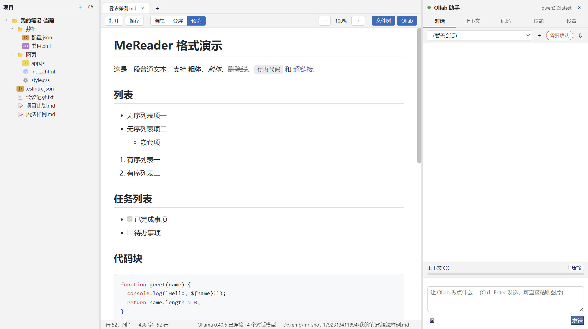
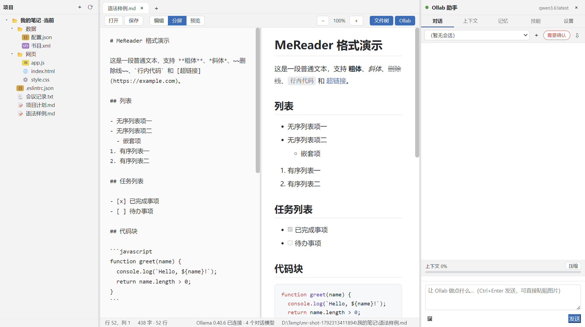

<div align="center">


# MeReader

**本地 Markdown 编辑器 + 内置 Ollama 助手 Ollab**

Electron 桌面应用 · 数据全在本机 · 记事本式的文件手感，IDE 式的项目与助手面板

[](https://github.com/akun666yyds/me-reader/releases)
[](https://www.electronjs.org/)
[](https://ollama.com/)
[](LICENSE)

</div>

---

## ✨ 功能特性

### Markdown 读写与排版

- 标题、粗体、斜体、删除线、链接、图片（本地相对路径自动解析）
- GFM 表格、任务列表复选框、嵌套列表、引用块、分割线、代码围栏
- 200+ 语言语法高亮（highlight.js），渲染前经 DOMPurify 消毒
- 4 套主题（浅色 / 深色 / 护眼绿 / 羊皮纸）、6 种正文字体、7 档字号、5 档行距
- 预览 / 分屏 / 编辑三种视图，分屏可拖分隔条、滚动自动同步

### 记事本式的文件体验

- **多标签**：内容、滚动位置、保存状态互相独立（Ctrl+T 新建 / Ctrl+W 关闭 / Ctrl+Tab 轮换 / 中键快关）
- **未保存可见**：标题 `●` 与标签脏点实时标记，关窗统一询问「保存 / 全部保存 / 不保存 / 取消」
- **会话自动缓存**：编辑内容 1.5 秒快照到本地，崩溃或断电后重开可完整恢复；保存干净后缓存自动清除
- 打开 / 保存 / 另存为 / 最近文件 / 拖文件进窗口，UTF-8 BOM 与 CRLF 自动处理，重命名标签会同步改磁盘文件名

### Ollab 助手：由本机 Ollama 驱动

- **本地模型**：面板内切换 Ollama 上的任意对话模型，自动识别 completion / vision / tools / thinking / embedding 能力；模型不在了会自动回退并提示
- **左侧项目文件树**：每个根目录就是一个项目，支持展开收缩、右键新建/重命名/移动/删除/导入；图标按类型区分（📂 目录、📝 md、📃 txt、🌐 html、`{}` json、`</>` xml、`JS` js/ts、⚙️ 配置、`.` 其它）
- **45 个工具**：读写与整理 Markdown / txt、json / xml 数据文档、轻量 H5 项目（html / css / js）、目录与检索、联网检索、计划与复盘、记忆、技能、向量检索
- **审批门控**：会话内两态「需要确认 / 自动审批」；写类工具在确认态逐项询问并给出差异预览，删除类操作任何时候都强制询问
- **上下文管理**：接近水位自动压缩，也可手动压缩或清除派生态重来；原始记录只追加，压缩只影响发给模型的视图
- **图片进上下文**：拖拽或粘贴图片到面板，视觉模型收到像素，非视觉模型只收到文件名说明
- **持久化**：配置、会话、记忆、技能、索引全部落盘，重启后可继续同一会话

### 联网检索（免密钥）

按本机可达性依次尝试 Bing 中国 → 百度 → 搜狗（可选 DuckDuckGo），自动处理 GBK 编码与跳转链接，返回标题、摘要、来源 URL；抓取网页正文供模型阅读并保留来源。

### 记忆、技能与轻量 RAG

- **记忆**：全局记忆在 `%APPDATA%\MeReader\agent\memory\global.json`，项目记忆在项目根 `.omemory\`（`memory.json` + 人类可读的 `notes/*.md`）
- **技能**：内置 6 份技能（Markdown 文档工作台、文档项目管理、数据文档管理、本地 H5 小项目、联网检索与来源核实、计划—执行—复盘工作法），可开关、可编辑，项目技能放在 `.oskill\`
- **RAG**：文件改动后自动增量索引，向量以 Float32→base64 存在 `.orag\index.json`，检索得分 `0.8×余弦 + 0.2×关键词` 并做 MMR 去重；无需任何数据库依赖

## 🖼 界面预览

| 预览 + 项目树 + Ollab 面板 | 分屏编辑 |
| --- | --- |
|  |  |

## 🛠 环境要求

| 依赖 | 版本 | 说明 |
| --- | --- | --- |
| Node.js | ≥ 18（建议 20+） | 含 npm |
| Electron | 31（`npm install` 自动装） | 桌面运行时 |
| Ollama | ≥ 0.3（实测 0.40.6） | 仅使用 Ollab 助手时需要 |
| 对话模型 | 具备 `tools` 能力 | 如 qwen3 系列；无工具能力时面板会提示只能纯文本交流 |
| 嵌入模型 | 可选 | 如 `nomic-embed-text`，只用向量检索/RAG 时需要 |

操作系统：Windows 10/11 打包便携 exe；开发运行同样支持 macOS / Linux。

## 🚀 从零开始：安装与运行

```bash
# 1. 克隆仓库
git clone https://github.com/akun666yyds/me-reader.git
cd me-reader

# 2. 安装依赖（国内网络建议换源）
npm install --registry=https://registry.npmmirror.com

# 3. 启动应用（开发/日常使用均可）
npm start
```

只想读 Markdown，到这里就够了。要用 Ollab 助手，再准备本地模型：

```bash
ollama serve                      # 默认监听 http://127.0.0.1:11434
ollama pull qwen3:30b             # 对话模型（需支持工具调用）
ollama pull nomic-embed-text      # 可选：向量检索用
```

启动后即为完整功能的桌面应用，也可以直接打开指定文件或指定项目：

```bash
npx electron . 你的文档.md
npx electron . D:\我的笔记目录      # 该目录会自动作为项目加入左侧文件树
```

> **首次安装 Electron 下载慢？** 设置镜像后再装：
> ```bash
> # Windows (PowerShell)
> $env:ELECTRON_MIRROR="https://npmmirror.com/mirrors/electron/"
> # macOS / Linux
> export ELECTRON_MIRROR=https://npmmirror.com/mirrors/electron/
> ```

## 🤖 Ollab 五分钟上手

1. 菜单「视图 → Ollab 助手面板」（或 Ctrl+Shift+A）打开右侧面板，顶部指示灯确认 Ollama 已连接，「设置」页选好对话模型。
2. 菜单「文件 → 添加项目文件夹...」（或 Ctrl+Shift+O）把目录加入左侧文件树，agent 的读写全部限制在项目目录内。
3. 在文档里选中一段文字再提问，选中内容会随请求一起给出上下文；隐藏的 `.omemory` / `.oskill` / `.orag` 是项目记忆、项目技能与索引，agent 可读，文件树不显示。
4. 写类工具会弹出审批卡片（含差异预览），可选「允许 / 拒绝」；把会话切到「自动审批」后仍会强制询问删除类操作。
5. 「上下文」页查看水位与压缩流水，可随时手动压缩或清除派生态；「记忆」「技能」页管理长期约定与工作流程。

## 📦 打包为 exe

```bash
# 一条命令，产物在 dist/ 目录
npm run dist
```

产物为单文件便携版：`dist/MeReader-Portable-1.1.0.exe`，双击即用、免安装。

国内网络首次打包需要下载 Electron 运行时与签名工具链，建议带上镜像变量：

```bash
# Windows (PowerShell)
$env:ELECTRON_MIRROR="https://npmmirror.com/mirrors/electron/"
$env:ELECTRON_BUILDER_BINARIES_MIRROR="https://npmmirror.com/mirrors/electron-builder-binaries/"
npm run dist

# macOS / Linux
ELECTRON_MIRROR=https://npmmirror.com/mirrors/electron/ \
ELECTRON_BUILDER_BINARIES_MIRROR=https://npmmirror.com/mirrors/electron-builder-binaries/ \
npm run dist
```

如需安装包（写注册表、开始菜单、文件关联），把 `package.json` 中 `build.win.target` 的 `portable` 改为 `nsis` 再执行 `npm run dist`。

自定义图标：把方形 logo 放到 `assets/source-logo.png`，运行 `npm run icon` 自动生成圆角 `icon.png` 与 `icon.ico`。

## 🧪 自测

```bash
npm test          # 离线自测：沙箱与文件树、Markdown 工具链、agent 循环契约（38 项，用假模型驱动同一套引擎代码）
npm run test:e2e  # 端到端：对着本机真实 Ollama 跑建文件 / 审批 / 拒绝 / 记忆 / 压缩 / 索引 / 重启续用
npm run smoke     # 启动真实应用，检查渲染进程无崩溃、三栏布局与面板就位
npm run screenshot # 用临时项目重新生成上面两张 README 截图
```

离线自测验证「循环契约」；`test:e2e` 验证「真实模型能否把工具体系用起来」，两者都跑在系统临时目录里，结束后自动清理，不碰用户文档。

## 📖 快捷键

| 操作 | 快捷键 | 操作 | 快捷键 |
| --- | --- | --- | --- |
| 新建标签页 | Ctrl+T | 打开文件 | Ctrl+O |
| 保存 | Ctrl+S | 另存为 | Ctrl+Shift+S |
| 添加项目文件夹 | Ctrl+Shift+O | 关闭标签页 | Ctrl+W |
| 切换标签 | Ctrl+Tab / Ctrl+Shift+Tab | 文件树开关 | Ctrl+Shift+E |
| 预览 / 分屏 / 编辑 | Ctrl+1 / 2 / 3 | Ollab 面板 | Ctrl+Shift+A |
| 放大 / 缩小 / 重置 | Ctrl+= / Ctrl+- / Ctrl+0 |  |  |

## 🗂 数据存放在哪

全局数据（跟着程序走，Windows 下为 `%APPDATA%\MeReader`，macOS/Linux 为对应 userData）：

```
MeReader/
├── settings.json              # 界面与阅读设置
├── autosave.json              # 未保存标签页快照
└── agent/
    ├── config.json            # 服务端、模型、能力开关、压缩阈值
    ├── projects.json          # 项目注册表（id ↔ 目录）
    ├── sessions/<id>.jsonl    # 会话：追加式原始历史
    ├── sessions/assets/       # 会话图片（内容寻址）
    ├── memory/global.json     # 跨项目长期记忆
    ├── skills/<name>.md       # 全局技能
    ├── rag/                   # 全局向量索引
    └── cache/tools/<hash>.md  # 超长工具输出落盘，上下文只留引用
```

项目数据（跟着项目走，可随项目一起提交或同步）：

```
<项目根>/
├── .omemory/memory.json       # 项目记忆
├── .omemory/notes/*.md        # 记忆条目（人类可读）
├── .oskill/<name>.md          # 项目技能
└── .orag/index.json           # 项目向量索引
```

从 MeReader-Lite 旧版本升级时，首次启动会把旧目录（`mereader-lite` / `MeReader-Lite`）里缺失的 `settings.json`、`autosave.json` 自动搬到新目录，不覆盖已有文件。

## 📁 项目结构

```
MeReader/
├── src/
│   ├── main/
│   │   ├── main.js            # 主进程：窗口、菜单、文件 IO、设置与会话缓存、agent 装配
│   │   ├── preload.js         # contextBridge 安全桥（禁用 nodeIntegration，通道白名单）
│   │   └── agent/
│   │       ├── engine.js      # Ollab 主循环：plan-act-reflect、工具执行、审批门控
│   │       ├── tools.js       # 45 个工具的注册表（kind / approval / schema）
│   │       ├── context.js     # 上下文水位与分层压缩（落盘 / 清理 / 摘要 / 事实）
│   │       ├── sessions.js    # 追加式 JSONL 会话与图片资源
│   │       ├── memory.js      # 全局 / 项目记忆
│   │       ├── skills.js      # 技能库与内置技能
│   │       ├── builtin-skills.js
│   │       ├── rag.js         # 轻量向量库（Float32→base64）
│   │       ├── websearch.js   # 免密钥多引擎检索与正文抓取
│   │       ├── workspace.js   # 项目注册与沙箱路径解析
│   │       ├── markdown.js    # 格式化 / 目录 / 表格等文档工具实现
│   │       ├── paths.js       # 数据目录规划（单一事实源）
│   │       ├── ollama.js      # /api/tags、/api/chat 流式、/api/embed
│   │       └── ipc.js         # 主进程 ↔ 渲染进程通道
│   └── renderer/
│       ├── index.html         # 三栏骨架 + 严格 CSP
│       ├── app.js             # 多标签文档模型、渲染与交互
│       ├── agent.js           # Ollab 面板：会话、审批、上下文、记忆、技能、设置
│       ├── filetree.js        # 左侧项目文件树
│       ├── ui.js              # 弹窗 / toast 等通用交互
│       ├── styles.css         # 编辑器与 4 套主题变量
│       ├── agent.css          # 三栏布局与面板样式
│       └── markdown.css       # Markdown 排版样式
├── scripts/
│   ├── build-icon.js          # logo → icon.png / icon.ico
│   ├── selftest-*.js          # 离线自测
│   ├── e2e-ollama.js          # 真实 Ollama 端到端
│   ├── smoke.js               # 启动真实应用做冒烟检查
│   ├── screenshot.js          # 生成 README 截图
│   └── lib/tmp-clean.js       # 测试临时目录与项目注册的自动清理
├── assets/                    # 应用图标
├── 样例.md                    # 全格式渲染演示文档
└── package.json               # 含 electron-builder 打包配置
```

## 🧩 技术栈

- [Electron](https://www.electronjs.org/) — 桌面应用框架（主进程 / 预加载 / 渲染进程隔离，严格 CSP）
- [Ollama](https://ollama.com/) — 本地模型服务（`/api/chat` 流式 + 工具调用、`/api/tags` 能力探测、`/api/embed` 向量化）
- [marked](https://github.com/markedjs/marked) — Markdown 解析（GFM）
- [highlight.js](https://highlightjs.org/) — 代码高亮
- [DOMPurify](https://github.com/cure53/DOMPurify) — XSS 消毒
- [electron-builder](https://www.electron.build/) — Windows 打包

## ❓ 常见问题

**双击 exe 报「已保护你的电脑」？** 本应用未做代码签名（开源个人项目无证书），SmartScreen 弹窗点「更多信息 → 仍要运行」即可。

**面板指示灯红色 / 提示连不上？** Ollama 未启动或端口不同，先 `ollama serve`，再在「设置 → 本地服务端」改地址；地址与模型都能在本机离线使用，无需联网。

**模型能聊天但不调工具？** 说明该模型不具备 `tools` 能力，Ollab 会提示本轮只能纯文本交流。请换支持工具调用的模型（如 qwen3 系列）。

**提示「固定开销装不下」？** 45 个工具清单 + 技能 + 记忆本身就接近当前 `num_ctx`。按报错建议值调大 `num_ctx`（模型上限会在提示里给出），或在设置里关掉不用的技能与工具。

**向量检索没结果？** RAG 需要嵌入模型：`ollama pull nomic-embed-text` 后在设置里选中，再到「设置 → 向量索引」点「重建项目索引」。没有嵌入模型时，文件读写、检索工具等仍照常工作。

**打开的 Markdown 里图片不显示？** 相对路径以 md 文件所在目录为基准解析，确认图片文件真实存在；网络图片需联网。

**数据会上传吗？** 不会。文档、会话、记忆、索引只写本机目录，模型只调用本机 Ollama；联网检索仅向搜索引擎发起公开查询请求。

## 📄 License

MIT © 2026 啊坤（akun666yyds@gmail.com）

详见 [LICENSE](LICENSE)。
